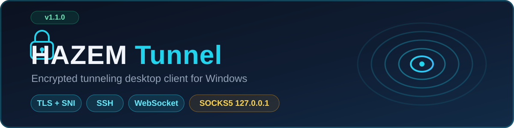

<div align="center">



# HAZEM Tunnel

**Route your configured apps through an encrypted tunnel — TLS+SNI, SSH, or WebSocket — via a local SOCKS5 proxy on `127.0.0.1`.**

[](https://github.com/hazmmhmdalshadhly12-ui/Tls/actions/workflows/ci.yml)
[](https://github.com/hazmmhmdalshadhly12-ui/Tls/releases/latest)
[](docs/BUILD_REPORT.md)
[](LICENSE)


[Download](#-download--run) · [Quick start](#-usage-in-60-seconds) · [Transports](#-transports) · [Build from source](#-build-from-source) · [Security](#-security-model) · [Docs](#-documentation)

</div>

---

## 📖 About

HAZEM Tunnel is a Windows desktop client (WPF, MVVM, .NET 10) that runs a **local SOCKS5 proxy** and relays its traffic through a **real encrypted tunnel** of your choosing: SSH, TLS with explicit SNI control, or WebSocket (`ws`/`wss`).

The app is built around one principle: **honesty**. "Connected" appears only after a *real through-tunnel health check* succeeds. Statistics show *real* relayed bytes. Nothing is faked, nothing is exaggerated, and secrets never touch disk in plaintext.

> **v1.2.1** keeps the v1.2.0 DI startup fix, upgrades the MSI to a **full program-folder
> install** (278 files into `%ProgramFiles%\HAZEM Tunnel`, MSZIP cabinet, close-on-install,
> download-verified integrity). See [CHANGELOG](CHANGELOG.md).

| ✅ What it DOES | ❌ What it does NOT do |
|---|---|
| Expose a local SOCKS5 proxy (default `127.0.0.1:1080`) | Route **all** system traffic (no system-wide VPN — planned) |
| Show **Connected** only after a real through-tunnel health check | Fabricate ping/latency/traffic numbers |
| Count **real** relayed bytes and rates | Provide "free internet" by itself — a public hostname/SNI never guarantees that |
| Store secrets in the OS credential store (DPAPI), never in profiles | Disable TLS certificate validation (impossible by design) |
| Verify SSH host keys (TOFU / Strict / Pinned) | Log passwords, keys, or traffic contents |

Only apps that are *configured to use the proxy* are tunneled. Everything else connects directly, unchanged.

---

## ⬇️ Install (like every other program) or go portable

**Option A — Windows installer (recommended):**

1. Get **`HAZEM-Tunnel-1.2.1-setup.msi`** from the [**Releases page**](https://github.com/hazmmhmdalshadhly12-ui/Tls/releases/latest).
2. Double-click → **Next → Install**. That's it.
3. Launch **HAZEM Tunnel** from the Start Menu or the desktop shortcut.
4. Uninstall any time from *Settings → Apps → Installed apps*.

Installs the **complete program folder** into `%ProgramFiles%\HAZEM Tunnel` (no TEMP
self-extraction at runtime — the app runs straight from Program Files), registers in
*Apps & features*, closes a running copy while upgrading, and upgrades cleanly over
older versions.

> 💡 If Windows ever reports *"The cabinet file 'cab1.cab' … is corrupt"*, the download
> was interrupted — re-download and verify with the attached `.sha256` file:
> `certutil -hashfile HAZEM-Tunnel-1.2.1-setup.msi SHA256`

**Option B — portable (no install):**

1. Get **`HAZEM-Tunnel-1.2.1-win-x64.zip`** from the [Releases page](https://github.com/hazmmhmdalshadhly12-ui/Tls/releases/latest).
2. Extract → run **`HAZEM.Tunnel.exe`**. **No .NET install needed** (self-contained, x64).

**Requirements:** Windows 10 1809+ / Windows 11, x64.

### SmartScreen note (unsigned build)
The EXE and MSI are **not code-signed**. Windows SmartScreen may show *"Windows protected your PC"*.
Click **More info → Run anyway**, or right-click the file → Properties → Unblock.
This is expected for self-published builds; future releases may be signed. Verify downloads
with the SHA-256 checksums published on each release.

---

## 🚀 Usage in 60 seconds

1. **Profiles → ＋ New** → pick transport → fill fields → **Validate → Save**.
   - SSH: host/port/username + password or PEM key (stored via DPAPI, not in the file).
   - TLS: dial host/port + **SNI** (kept separate from dial host on purpose).
   - WebSocket: full `wss://host:port/path` URL.
   - Remote forward target (SSH transports): what the SSH server connects to (the exit).
2. **Dashboard** → select profile → **Connect**.
   Stages run: proxy → transport → **through-tunnel health check** → Connected.
3. Point any app at `127.0.0.1:1080` (SOCKS5). Examples:
   - `curl --proxy socks5h://127.0.0.1:1080 https://ifconfig.me`
   - Browsers: use a proxy extension (e.g. FoxyProxy) → SOCKS5 → 127.0.0.1 → 1080.
4. **Statistics / Logs** pages show real counters and redacted logs.

---

## 🔀 Transports

| Transport | Details | Credentials |
|---|---|---|
| **TLS + SNI** | Raw TLS to a dial endpoint with an independent SNI hostname (system trust store + optional pinned CA PEMs) | None / client certificate |
| **SSH** | Full SSH2 session via SSH.NET; password **or** PEM private key; host keys verified (TOFU / Strict / Pinned) | Password or key (DPAPI-encrypted) |
| **SSH over TLS** | Bridges the SSH transport inside a TLS session — two layers, one connection | Both of the above |
| **WebSocket** | `ws://` / `wss://` with configurable path, headers, and keep-alive | Optional headers |

All transports funnel into one local **SOCKS5 (RFC 1928/1929)** listener — CONNECT only, loopback by default.

---

## 🛠 Build from source

Requires **.NET SDK 10** (pinned in [`global.json`](global.json)):

```powershell
git clone https://github.com/hazmmhmdalshadhly12-ui/Tls.git
cd Tls
scripts\build.ps1     # build (0-warnings policy)
scripts\test.ps1      # run all unit tests (3 projects, live loopback suites)
scripts\publish.ps1   # self-contained win-x64 single-file EXE + zip
```

The full solution builds on Linux too (`dotnet build` with `EnableWindowsTargeting` already set in the App project); only *running* the WPF UI requires Windows. Every push to `main` is built and tested automatically by [GitHub Actions](.github/workflows/ci.yml).

---

## 📂 Where my data lives

| Data | Location |
|---|---|
| Profiles | `%LocalAppData%\HAZEMTunnel\profiles\*.json` |
| Secrets (DPAPI blobs) | `%LocalAppData%\HAZEMTunnel\data\credentials\` |
| Known SSH hosts | `%LocalAppData%\HAZEMTunnel\data\known-hosts.json` |
| Rotating logs | `%LocalAppData%\HAZEMTunnel\logs\hazem-YYYYMMDD.log` (size-sequence rotation, retention-cleaned) |

---

## 📚 Documentation

- [`docs/CONFIG_SCHEMA.md`](docs/CONFIG_SCHEMA.md) — strict v1 profile schema + import/export rules
- [`docs/MANUAL_TESTING.md`](docs/MANUAL_TESTING.md) — manual QA checklist
- [`docs/BUILD_REPORT.md`](docs/BUILD_REPORT.md) — exact build/test/publish steps and honest scope
- [`CHANGELOG.md`](CHANGELOG.md) — version history
- [`installer/`](installer/) — optional Inno Setup installer script
- [`samples/profiles/`](samples/profiles/) — ready-to-edit example profiles (TLS / SSH / SSH-over-TLS / WebSocket)

---

## 🔐 Security model

- TLS validation is **always on** (system roots + optional pinned CA PEMs that *add* trust).
- SSH host keys: first-use pinned locally; a changed key **always** fails the session (TOFU/Strict/Pinned).
- Secrets live in DPAPI-encrypted blobs; profiles carry only opaque `{ "key": … }` references.
- Logs are redacted (passwords/tokens/PEM bodies/pattern-registered secrets) before hitting disk.
- The SOCKS5 proxy binds to loopback unless you explicitly enable LAN binding (with a warning).

Found a vulnerability? Please use [**private security advisories**](https://github.com/hazmmhmdalshadhly12-ui/Tls/security/advisories/new) instead of a public issue — see [`SECURITY.md`](SECURITY.md).

---

## ⚠️ Known limitations (honest)

- No system-wide VPN (Wintun-based) — marked "Planned" in the UI.
- The EXE is unsigned (SmartScreen, see above).
- WPF app runs on Windows only; the tooling builds on any OS.
- SOCKS5 supports CONNECT only (no BIND/UDP-ASSOCIATE) — sufficient for HTTP(S) and most TCP clients.

---

## 🤝 Contributing

Contributions are welcome! Please read [`CONTRIBUTING.md`](CONTRIBUTING.md) first — it covers the dev setup, the 0-warnings build policy, and the testing expectations (`scripts\test.ps1` must stay green).

---

## 📜 License

[MIT](LICENSE) · Third-party: SSH.NET (MIT), .NET runtime (MIT).

<div align="center">
<sub>Built with ❤️ for Windows — HAZEM Tunnel v1.2.1</sub>
</div>
